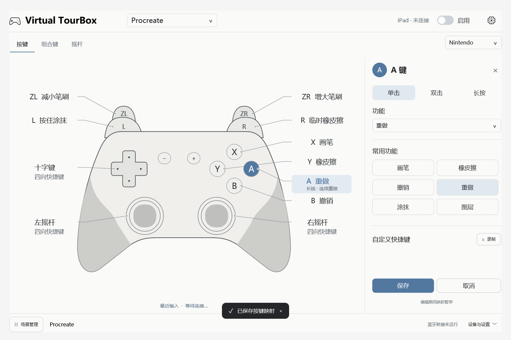

# Virtual TourBox

用手柄控制 Windows 绘画快捷键，或通过 Windows 电脑的 BLE HID 桥接操作 iPad Procreate。

**v0.2.5 预览版**：新增独立短按/长按已通过自动检查，本版尚未完成 iPad 实机验收。

图片来自真实 WPF 界面的离屏渲染，使用示例配置；不能据此判断连接状态或硬件兼容性。

## 下载与运行

在仓库右侧 **Releases** 下载以 **win-x64.zip** 结尾的附件。GitHub 自动生成的 Source code 压缩包是源码，不能直接运行。

1. 完整解压到固定目录，不要只复制单个 exe。
2. 退出旧版 Virtual TourBox 和独立运行的 BleHid App/CLI。
3. 运行 VirtualTourBox.exe。自包含运行包无需另装 .NET。
4. 连接手柄，在“设备与设置”选择设备，必要时刷新。
5. 选择场景，打开顶部“启用”开关。

请保留 BleHid、Defaults 和 licenses 子文件夹。关闭窗口会退出软件；继续后台映射请使用设置中的“转入后台”。

## 使用条件

- Windows x64；iPad 桥接要求 Windows 10 2004/build 19041 或更新系统，以及支持 **BLE peripheral role（低功耗蓝牙外设角色）** 的蓝牙适配器。
- 能连接蓝牙耳机不代表支持该外设角色，兼容性需在本机检查。
- 手柄连接电脑，电脑通过 BLE HID 向 iPad 发键盘输入；iPad 安装 Procreate。
- 这不是手柄固件烧录工具，映射期间电脑和软件必须运行。
- 不需要 TourBox 硬件，不保证所有手柄即插即用。

## 功能与验证状态

| 功能 | 状态 |
|---|---|
| Windows 快捷键、录制器、暂停后无输出 | 历史用户实机通过 |
| Procreate 画笔/橡皮擦、撤销/重做、选区/变换/图层/颜色、笔刷大小、快捷菜单 | 历史用户实机通过 |
| 临时涂抹、临时橡皮擦、连发、双击、组合键 | 历史独立功能有实机通过记录 |
| X/Y 同键独立短按与长按、A/B 独立映射配对连发 | 本版自动检查通过，iPad 实机待验收 |
| 场景保存、导入/导出、备份/恢复、死区与按压保护、手动校准 | 已实现，部分历史版本有实机通过记录 |
| 后台托盘、开机启动、CLI 路径记忆、日志和连接状态 | 已实现，环境差异仍需验证 |
| 摇杆四向快捷键 | 已实现，不是连续画布操作 |
| 桥接进程异常自动重启 | 已搁置 |
| 画布连续平移/旋转/缩放、颜色连续调整、一键液化/翻转 | 未实现 |

“已提交命令”不等于 iPad 已执行。历史通过不代表本版全部回归通过。

## 默认 Procreate 映射

| 按键 | 短按 | 长按 |
|---|---|---|
| A | 重做一次 | 连续重做 |
| B | 撤销一次 | 连续撤销 |
| X | 画笔 | 临时涂抹 |
| Y | 橡皮擦 | 临时橡皮擦，松开回画笔 |
| L | 图层 | 无 |
| ZL/左扳机 | 颜色面板 | 无 |
| ＋/Start | 快捷菜单 | 无 |
| 十字键上/下 | 增大/减小笔刷 | 无独立长按，按住重复调整 |
| 十字键左/右 | 选区/变换 | 无 |

其余普通键、双击、组合键、摇杆方向默认不绑定。

- X/Y 长按约400 ms触发，短按在松开时执行；长按不会补发短按。
- A/B 配对映射按下先执行一次，再按连发设置的等待和间隔持续执行，松开停止。
- 设置双击后，单击需等待约300 ms识别窗口。
- 编辑期间映射暂停，保存后手动重新启用。
- 单击、双击、长按分别保存。旧配置普通行直接设置按住工具仍兼容。
- 临时橡皮擦松开后固定返回画笔，不是恢复任意之前的工具。
- 快捷菜单打开后需在 iPad 点选。

已有配置不自动覆盖。采用新默认：选择 iPad 场景，在“组合键”页点击 **恢复默认映射** 并确认，恢复前自动备份。也可以新建一个 iPad 场景。

## 连接 iPad

1. 退出其他 BleHid App/CLI，避免争用服务。
2. 打开“设备与设置”，程序优先使用随包 BleHid/BleHid.Cli.exe，一般无需手选路径。
3. 启动服务，在 iPad 蓝牙设置与电脑广播出的 HID 设备配对。
4. 检查状态并核对目标。当前提供“选第1台设备”，只有确认第一台确实是自己的 iPad 时才使用。
5. 键盘订阅有效后，先在 iPad 备忘录文本框测试字母 b，再进入 Procreate 启用映射。
6. 可开启软件启动时自动尝试启动服务；自动连接仍取决于蓝牙、配对记录与目标确认。

涂抹需在 Procreate **手势控制 → 涂抹** 开启“□ + Apple Pencil”。默认使用 Alt/Option 保持模式，历史测试为 iPadOS 18.7.8；“iPadOS17及以下”的旧模式保留为兼容实验选项，未保证所有版本。
**判断涂抹请看实际笔触，不能只看右上角图标。**

## 手柄兼容性

| 手柄 | 说明 |
|---|---|
| IINE L1807有线 | 有历史实机记录，本版新手势待回归 |
| 官方Xbox/XInput兼容手柄 | 有代码支持基础，未验证所有型号和连接方式 |
| PlayStation/Nintendo官方手柄 | 没有完整专用适配或实机保证 |

优先读 XInput，无可用 XInput 时回退 WinMM。当前发现 XInput 后会跳过 WinMM，因此混合连接时部分设备可能不显示。
Nintendo/Xbox/PlayStation 选项主要切换显示布局，**不是驱动或协议适配**。其他手柄可能需要手动校准按钮编号、扳机和轴。

## 配置与常见问题

配置在 **%APPDATA%/VirtualTourBox/**，settings.json 保存运行选项、设备校准与连发参数，profiles/ 保存场景。升级不清空配置。

有输入但无输出：
- 检查启用状态与场景目标。
- Windows 快捷键发给前台窗口，测试时切回记事本或绘画软件。
- iPad 检查目标确认、键盘订阅与日志，必要时重新配对。
- iPad 自定义组合快捷键目前未完整支持；内置撤销/重做使用专门的 Cmd 组合指令。

提示 BleHid 已运行：退出此前后台服务再启动，不要同时运行两个桥接。

已知界面问题：选中编辑与实际按下暂时同色，后续区分。动作列表里标记待实现的画布功能不能作为可用功能使用。

## 源码构建

需要 Windows、.NET 8 SDK 或兼容 SDK，以及还原依赖的网络。

~~~powershell
dotnet run --project tests/HoldGestureChecks -c Release
dotnet build src/VirtualTourBox/VirtualTourBox.csproj -c Release
powershell -ExecutionPolicy Bypass -File scripts/Build.ps1
~~~

最后一条生成 dist/VirtualTourBox-v0.2.5-preview-win-x64/，包含本仓库第三方源码构建的桥接。早期仅补 combo 的脚本不再作为重建流程。

## 反馈与许可

在 GitHub Issues 提供软件/系统/iPadOS/Procreate版本、手柄型号与连接方式、复现步骤。日志先删去蓝牙设备地址、设备标识和个人路径。

项目主体是**源码可查看的非开源项目**，见 LICENSE.txt：允许个人使用、查看和本地修改，未经作者书面许可不得发布修改版或衍生版本。公开仓库仍受 GitHub 查看/Fork 条款约束。
第三方 windows-ble-hid 保留 MIT，.NET 等保留自身许可，根目录许可不能撤销第三方已有权利。见 THIRD_PARTY_NOTICES.md。
